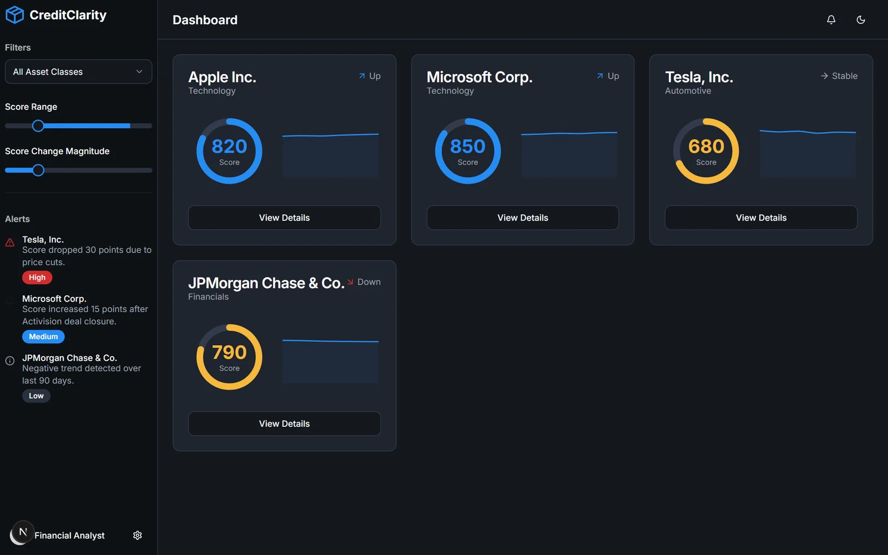

<div align="center">


**Explainable credit intelligence: live creditworthiness scores for issuers, with the events and features that moved each score, explained in plain language.**

[Live demo](https://creditclarity-ai.vercel.app)



</div>

## What it does

Credit ratings change slowly and rarely say why. CreditClarity combines structured financial data with unstructured news to keep a near-real-time score for each issuer, and shows its reasoning:

- **Score cards** for each issuer: the current score on a gauge, its trend, and whether it is moving up, down or holding stable.
- **Alerts** for sudden score changes, ranked high, medium or low (for example "Score dropped 30 points due to price cuts").
- **Filters** by asset class, score range and score-change magnitude.
- **Explanations**: *View details* opens an issuer's feature contributions and recent events. A Gemini flow then writes a plain-language explanation of why the score moved from its old value to the new one.
- **Event extraction**: a second flow reads a financial news headline and pulls out credit-relevant events with their entities, sentiment and relevance score.

The issuer data in this build is demo data (`src/lib/mock-data.ts`).

## How it works

```
news headlines ──► extract-credit-events (Gemini) ──► events + sentiment + relevance
                                                         │
financial features ──────────────────────────────────────┤
                                                         ▼
                                              issuer score + history
                                                         │
                                 generate-score-explanation (Gemini) ──► "why it moved"
```

Both flows are in `src/ai/flows`. The server action that calls the explanation flow is in `src/app/actions.ts`.

## Tech stack

Next.js 15, React, TypeScript, Tailwind CSS, shadcn/ui (Radix UI), Genkit with Google AI (Gemini). Set up for Firebase App Hosting (`apphosting.yaml`).

## Run locally

```bash
npm install
echo GEMINI_API_KEY=your_key > .env
npm run dev              # http://localhost:9002
npm run genkit:dev       # optional: Genkit developer UI
```
